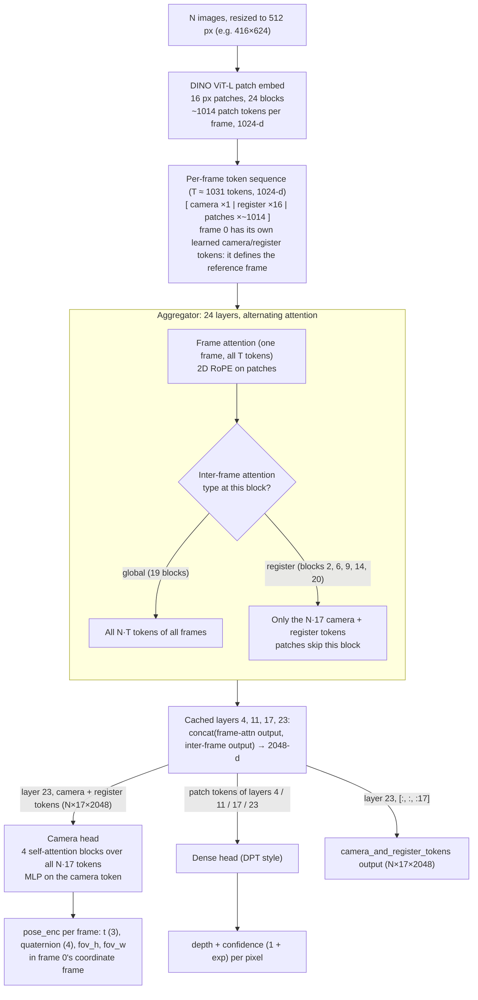
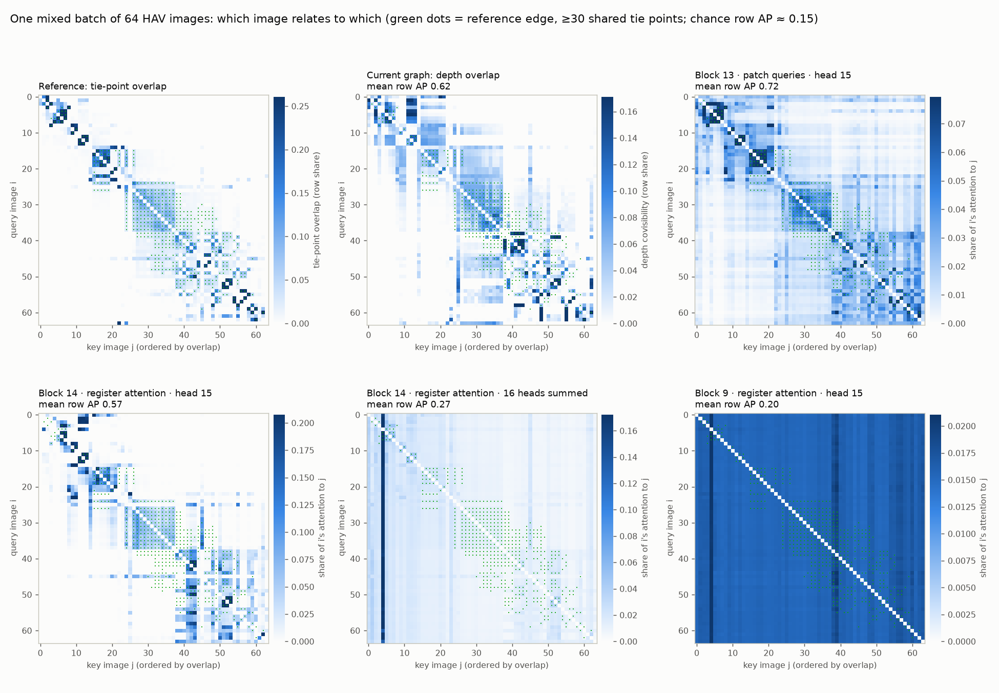
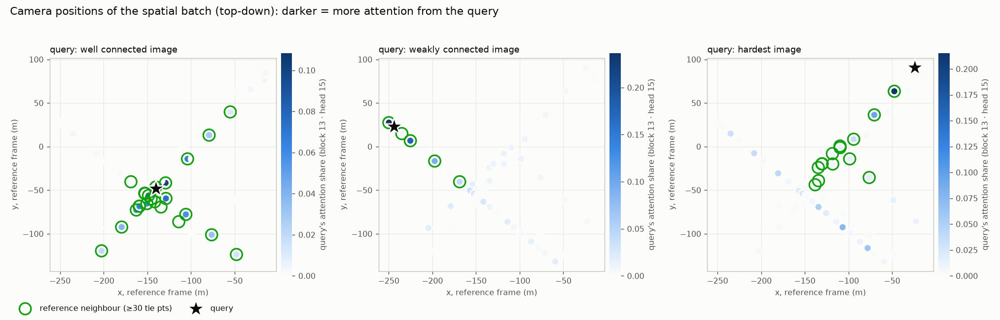

# Explicit Geometry Register (EGR)

Status: design, not implemented. Part of FG-SfM ([README](../README.md)).

## 1. Idea

VGGT-Ω gives every frame a camera token and 16 **registers** (scene tokens). Inside one forward pass these
tokens carry the cross-frame scene information and are consumed by the following layers and the camera head.
Their memory is **implicit**: it exists for one pass, and making it cover more images means a larger batch.

EGR makes that memory **explicit**. A small batch of related images (e.g. 16) is run once; its final camera
and register tokens are **stored in the node of our scene graph** that the batch forms, as that node's
descriptor. Merging is then done on descriptors, not images: the stored tokens of several nodes are fed
together to the part of VGGT-Ω that relates frames and outputs camera poses, which places all of their images
in one frame. The graph replaces the large batch: instead of one big pass we do several cheap passes over
stored tokens.

## 2. What VGGT-Ω provides (from the released code)

- **Aggregator:** 24 alternating blocks, each one frame-wise attention + one inter-frame attention. The
  inter-frame step is global (all tokens of all frames) in 19 blocks and **register attention** (only camera
  and register tokens attend across frames) in blocks 2, 6, 9, 14 and 20.
- **Tokens per frame:** 1 camera token + 16 registers + the patch tokens (16 px patches; 26 × 39 = 1014 patches for a
  512 px 3:2 image, resized to 416 × 624). The first frame of a batch gets its own learned camera/register embedding: it defines
  the batch's reference frame.
- **Output:** the final-layer `camera_and_register_tokens`, 17 × 2048 values per frame.
- **Camera head:** a 4-block transformer over the camera and register tokens of **all frames** of the batch,
  then a per-frame MLP on the camera token → translation, quaternion, field of view. **It never reads patch
  tokens**: poses are decoded from exactly the tokens EGR stores.
- **Depth head:** reads patch tokens of layers 4, 11, 17 and 23. Not needed for merging; depth comes from
  pass 1.

Architecture, drawn from `models/aggregator.py`, `models/layers/{block,attention}.py` and
`models/heads/{camera,dense}_head.py`:



Every attention block, frame or inter-frame, is the same pre-norm transformer block:
- 16 heads of 64 channels, with QK-LayerNorm.
- Each head computes its own softmax over the keys. There is no mask, so a token attends to its own frame and to the other frames in the same softmax.
- The 16 head outputs are concatenated, projected, scaled by LayerScale and added to the residual. A GELU MLP (4× width) follows.
- Inter-frame blocks have **no positional encoding**. Frames are told apart only by their content, plus frame 0's own learned tokens.

A register block is therefore self-attention over 17·N tokens and costs about (17N)² per head, against (1031N)² for a global block.

## 3. Implicit vs explicit

| | VGGT-Ω (implicit) | EGR (explicit) |
|---|---|---|
| Where registers live | inside one forward pass | in the scene-graph node of the batch that made them |
| Lifetime | consumed by the next layers, then gone | persistent; reused by every later merge |
| Cross-frame reasoning | attention over all frames of the batch | camera head over the stored tokens of several nodes |
| How coverage grows | larger batch (43 GB at 500 frames on an A100) | more merge passes over stored tokens |
| Cost of relating 64 images | 64 frames × ~690 tokens through 24 blocks | 64 × 17 = 1,088 tokens through 4 head blocks |
| Who chooses what to relate | everything in the batch | the graph: candidate nodes only |

## 4. Passes

**Pass 1: leaf nodes.** Batches of ~16 related images (the current sweep windows, or GPS/BEV neighbours).
Full VGGT-Ω forward. Each node stores:

| Field | Size | Use |
|---|---|---|
| camera + register tokens | 16 × 17 × 2048 (bf16 ≈ 1.1 MB) | the node's descriptor, input to merges |
| poses, intrinsics | per image | node-internal geometry, as today |
| depth + confidence (sampled) | per image | metric scale, overlap gates, dense 3DGS init (as today) |

**Pass 2: merge.** For a candidate set of nodes (e.g. 4 nodes = 64 images), concatenate their stored tokens
and run the camera head → poses of all 64 images in one frame. From those poses:
- **which nodes truly belong together:** images shared by two nodes must come out consistent; predicted
  footprint overlap between nodes must agree with their depth;
- **the Sim(3) between node frames:** from the merged poses of each node's images vs that node's own pass-1
  poses (rotation and translation direction from the head; scale from pass-1 depth, as in today's chaining).

**Higher levels.** A merged node keeps its children's tokens (or a selection of them) as its descriptor, so
the next merge feeds e.g. four merged nodes' descriptors together with a candidate island to decide which
parts really need to merge. Our expectation is that pass 2 already does most of the work; higher levels are
for linking islands that pass 2 could not.

Precise geometry stays where it is: overlap gates, the final coarse BA, matching and global BA are unchanged.
EGR replaces the image-level linking (Sim(3) chaining through shared cameras, BEV ring search, exhaustive
fallback) with merging on stored descriptors, and needs no GPS to do it.

## 5. The main question: is merging on stored tokens valid?

The camera head was trained only on tokens from **one joint pass**. Tokens stored by separate passes differ in
two ways:
1. **Each node has its own reference frame.** Every node's first frame carries the reference embedding, so a
   merge input contains several "reference" frames, which the head never saw.
2. **The tokens of different nodes never attended to each other.** All relations between nodes must be
   decoded in the head's 4 blocks from what the registers already hold.

So EGR-0 tests this zero-shot first, and EGR-1 fixes it by training only the head if needed:
- **Distillation for free:** the teacher is VGGT-Ω on the joint 64-frame batch (fits on a 24 GB GPU); the
  student is the camera head (initialised from VGGT-Ω's) on 4 × 16 stored tokens. Any image collection is
  training data; no ground truth is needed. The aggregator stays frozen.
- Options for the reference-frame issue: mark one node's first frame as the merge reference (others
  re-embedded as non-reference), or add a learned per-node embedding.

## 6. Stages

| Stage | Content | Done when |
|---|---|---|
| EGR-0 | zero-shot merge test on HAV (below) | go / no-go and the failure mode, if any |
| EGR-1 | head distillation on stored tokens (only if EGR-0 falls short) | merged poses within ~2× the joint-pass error |
| EGR-2 | merge operator in the graph builder (`--link-mode register`) | HAV builds without GPS at the same final accuracy |
| EGR-3 | higher-level merges; SZTU (1500 images): RTK → consumer GPS → no GPS | no-GPS run registers all images at RTK-run accuracy |

**EGR-0 protocol** (HAV, Bentley AT as reference):
1. Pick 64 connected images; split into 4 nodes of 16. Variants: no shared images, and 4 images shared
   between neighbouring nodes (our sweep layout).
2. Joint pass: VGGT-Ω on all 64 → poses (the upper bound).
3. Pass 1: VGGT-Ω on each node → store tokens. Sanity check: the head on one node's stored tokens reproduces
   that node's own poses.
4. Pass 2: the head on the 4 nodes' tokens concatenated → poses for all 64.
5. Compare against Bentley and against the joint pass: relative rotation error and AUC@5, split into
   within-node and **between-node** image pairs; also node order and the reference-frame variants.

Go if between-node rotation error is within ~2× of the joint pass; otherwise go to EGR-1.

## 7. Risks and practical notes

- **License:** VGGT-Ω code and weights are under the **FAIR Noncommercial Research License**: research use
  only, no commercial use of the model or its outputs. A customer product needs a different backbone
  (e.g. a commercially licensed VGGT checkpoint) or an agreement with Meta; check VGGT-1B's terms too.
- **Weights:** gated on Hugging Face (access request). Checkpoints: 1B-512 (recommended), 1B-416
  (reproduction), 1B-256 (text alignment).
- **Memory:** 13.4 GB at 100 frames, 43 GB at 500 (A100); 16-frame leaves and 64-frame teachers fit on 24 GB.
- **Information limit:** the paper reports that replacing *all* global attention with register attention
  lowers accuracy, so registers do not carry everything. EGR only asks them to carry enough to relate nodes;
  pass-1 tokens themselves are full quality.
- **Scale:** the head's translations are in normalized units per merge; metric scale stays with pass-1 depth
  and the GPS / BA stages.

## 8. Probe: which attention relates images?

Script: `scripts/egr_attention_mass.py`.

For each inter-frame block and head, the probe measures the attention mass that frame i's queries send to all tokens of frame j:
- Queries are frame i's camera token, its 16 registers, or 64 evenly spaced patches (patches only in global blocks).
- The mass is summed over frame j's keys and averaged over frame i's queries.

The softmax makes keys compete within one query's row, so this mass can only be compared **within a row and within a batch**, never across batches. The scoring follows from that:
- Drop the self-frame mass and renormalise the row.
- **Row AP:** for each query image, rank the other images against the Bentley tie-point graph (edge = ≥30 shared tie points), then average over the images.
- **Batch AP / ρ:** the pair score averaged over both directions, scored within one batch, then averaged over the batches.
- **Heads:** the best head is chosen on 5 of the 6 batches and tested on the 6th (leave one batch out).

Test set: 6 HAV batches of 64 images (2 spatial, 2 random, 2 mixed). Our earlier probes pooled max- or mean-pooled scores across batches. That compares scores across different softmaxes and came out at chance.

| Score | Row AP | R-precision | Batch AP | ρ vs overlap |
|---|---|---|---|---|
| Chance | ~0.18 | | ~0.17 | |
| Final depth-reprojection overlap (current graph) | 0.644 | 0.540 | 0.538 | 0.76 |
| Blocks 2 / 6 / 9, register attention, best head | 0.25–0.29 | | 0.18–0.26 | ~0 |
| Block 10, global, patch queries, head 3 | 0.725 | 0.630 | 0.618 | 0.66 |
| **Block 13, global, patch queries, head 15** | **0.780** | **0.690** | **0.663** | 0.65 |
| Block 14, register attention, head 15 | 0.695 | 0.609 | 0.617 | 0.67 |
| Block 14, register attention, 16 heads summed | 0.383 | 0.338 | 0.297 | 0.27 |
| Block 15, global, patch queries, head 11 | 0.783 | 0.686 | 0.667 | 0.69 |

- **Where the relation forms:** at blocks 10–15, not in the early register blocks. It appears first in patch-to-patch attention (block 10). Block 14 is the first register block where it shows. It fades after block 17.
- **One head per block carries it:** the same head wins in every leave-one-batch-out split. Summing the heads drowns it in anchor-frame attention, visible as one dark column in the figure below.
- **It beats the current graph's measure:** one head at block 13 ranks neighbours better than the full model's depth overlap (+0.14 row AP), after 14 of the 24 layers and without the heads.
  - It is weaker at grading *how much* two images overlap (ρ 0.65 vs 0.76).
  - It can be fooled by look-alike structures, such as repeated villa rows.
- **Self-attention as a no-match signal:** a query's attention to its own frame grows when it has no real neighbour in the batch (15% for a well-connected image, 40–70% for weakly connected ones). This could be used as a "no match" signal.
- **Scope:** the score holds only within one batch. Candidate batches still come from GPS, a sequence window or retrieval. Mid-layer registers are batch-dependent and do not work as cross-batch descriptors: the same image in another batch is its own nearest neighbour only 20–50% of the time from block 13 on.
- **Not yet confirmed on other scenes:** so far this is HAV only. The heads still need confirming on CUHK_LOWER and CUHK_UPPER.




```bash
python scripts/egr_attention_mass.py --scene $SCENE    # metrics.json + per-head matrices (mass.pt) in runs/egr_attention_mass
python scripts/egr_attention_viz.py  --scene $SCENE    # matrices / per-query thumbnails / camera maps in runs/egr_attention_viz
```

`scripts/egr_register_affinity.py` holds the batch sampler and the earlier pooled-score probe, kept for reference.

## 9. Related work

| Work | How parts are joined |
|---|---|
| VGGT-Ω (2026) | implicit registers inside one forward pass |
| VGGT-Long / VGGT-SLAM | chunks joined by Sim(3) on overlapping frames / loop closures (geometry, not tokens) |
| G3AR (2026, multi-sequence aerial) | chunk graph, Sim(3) from shared images |
| FG-SfM today | VGGT batches joined by Sim(3) through shared cameras, GPS-guided linking |

As far as we know, no method stores foundation-model registers in a scene graph and merges reconstructions by
re-running the model's head on stored tokens.

References: [VGGT-Ω paper](https://arxiv.org/abs/2605.15195), [VGGT-Ω code](https://github.com/facebookresearch/vggt-omega),
[G3AR](https://arxiv.org/pdf/2609.16603), [VGGT-SLAM](https://arxiv.org/pdf/2505.12549).
